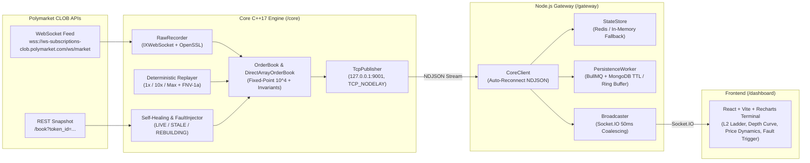

# Real-Time Orderbook Engine for Prediction Markets (Polymarket CLOB)

A high-performance, deterministic C++17 Limit Order Book (CLOB) engine, self-healing market-data pipeline, Node.js WebSocket gateway, and real-time React trading dashboard built around Polymarket prediction market feeds.

---

## System Architecture



---

## Key Features & Engineering Highlights

- **Fixed-Point Arithmetic (`10^4` scaling)**: Eliminates IEEE-754 floating-point key drift (`PRICE_SCALE = 10000`, `QTY_SCALE = 10000`).
- **Dual Book Implementations**:
  - `OrderBook`: Baseline Red-Black Tree (`std::map`) with matching engine and quantitative signals (`spread`, `mid_price`, `micro_price`, `book_imbalance`).
  - `DirectArrayOrderBook`: Flat 10,001-slot price-tick array exploiting Polymarket's bounded `[0.0000, 1.0000]` domain for $O(1)$ indexing and L1 cache locality.
  - `FastMatchingBook`: $O(1)$ doubly linked list (`std::list<Order>`) cancellation with stored iterator lookup.
- **Invariant Enforcement**: Validates no crossed book ($\text{Best Bid} < \text{Best Ask}$), strictly positive liquidity ($Q > 0$), and strict price monotonicity on every tick (**12,992 checks, 0 violations** on a 30-minute live capture).
- **Self-Healing State Machine**: Detects desyncs without sequence numbers (via timestamp regression and invariant triggers), transitions through `LIVE` $\rightarrow$ `STALE` $\rightarrow$ `REBUILDING` $\rightarrow$ `LIVE`, and recovers bit-for-bit via snapshot injection across seeded fault injections.
- **Bit-for-Bit Deterministic Replay**: Replays recorded feeds with variable pacing and dual-layer 64-bit FNV-1a state hashing (`0x7bf683492c841f21` verified identical across independent passes).
- **Resilient Gateway & 60fps UI**: Streams NDJSON over TCP (`TCP_NODELAY`), coalesces updates to 50ms per token in Socket.IO, and supports zero-config in-memory fallback when Redis/MongoDB are unavailable.

---

## Empirical Benchmark Results

Measured on Windows 11 (`x86_64`), MinGW-w64 GCC 15.2.0 (`-Wall -Wextra -Wpedantic -O2 -std=c++17`), replaying **12,982 real Polymarket delta updates** pre-loaded into RAM across 5 trials with warmup (`.\build\bench_comparison.exe data/polymarket_recording.jsonl`). Full methodology in [`docs/benchmarks.md`](docs/benchmarks.md).

| Implementation | Mean Throughput | Mean Latency | Median (p50) | p99 Latency | p99.9 Latency |
| :--- | :--- | :--- | :--- | :--- | :--- |
| **Baseline `std::map` (RB-Tree)** | 5,474,707 ops/s | 162.32 ns | 100.00 ns | 460.00 ns | 10,440.00 ns |
| **`DirectArrayOrderBook` (Flat Array)** | **7,393,280 ops/s** | **108.02 ns** | **100.00 ns** | **280.00 ns** | **1,720.00 ns** |
| **Speedup / Improvement** | **+35.0% throughput** | **33.5% faster** | — | **39.1% lower** | **6.07x lower tail** |

---

## Repository Layout

```text
/core        C++17 engine (OrderBook, DirectArrayOrderBook, FastMatchingBook, RawRecorder,
             FaultInjector, Replayer, StateHasher, TcpPublisher, LiveEngine, CTest suites)
/gateway     Node.js Express + Socket.IO bridge, Redis StateStore, BullMQ/MongoDB PersistenceWorker
/dashboard   React + Vite + Recharts real-time L2 terminal UI
/data        Sample and golden replay fixtures (large captures gitignored)
/docs        Feed protocol notes (feed-notes.md) & benchmark report (benchmarks.md)
DECISIONS.md Architectural Decision Records (ADR-001 through ADR-012)
Dockerfile   Multi-stage build (C++ builder + Vite builder + Node.js runtime)
render.yaml  Render Blueprint spec for one-click Docker deployment
```

---

## Quick Start (Local)

### Prerequisites
- C++17 compiler (MinGW-w64 GCC / Clang / GCC), CMake $\ge$ 3.15, Ninja, OpenSSL, ZLIB, `nlohmann_json`
- Node.js $\ge$ 20 & npm

### Build & Run Tests
```powershell
# Configure & build C++ targets + React production bundle
cmake -B build -G Ninja
npm run build

# Run C++ unit/property/determinism tests + Gateway tests + Full-Stack E2E test
npm test
```

### Launch Full Stack
```powershell
# Replay recorded 30-minute Polymarket feed at 1x real-time speed and open UI
npm start

# Or connect directly to live Polymarket WebSocket feed:
.\start_all.ps1 -Live
```
Dashboard opens at **`http://localhost:4000`**.

---

## Deploying to Render

This repository includes a multi-stage [`Dockerfile`](Dockerfile), [`docker-entrypoint.mjs`](docker-entrypoint.mjs), and [`render.yaml`](render.yaml) Blueprint configured for Render Web Services:

1. Push this repository to GitHub.
2. In the [Render Dashboard](https://dashboard.render.com/), choose **New +** $\rightarrow$ **Blueprint** (or **Web Service** $\rightarrow$ **Docker**).
3. Select the repository. Render detects `render.yaml` automatically (`runtime: docker`, health check `/api/health`, `ENGINE_MODE=live`).
4. *(Optional)* Add `REDIS_URL` and `MONGO_URI` environment variables in Render to enable external Redis state caching and MongoDB TTL persistence; if omitted, the gateway uses its resilient in-memory cache and ring-buffer fallback automatically.

---

## Problems Encountered & Engineering Solutions

| Problem | Root Cause | Solution |
| :--- | :--- | :--- |
| **Polymarket L2 book drift** | `price_change` feed sends *replacement aggregate size*, not cumulative deltas, and omits levels only when `size == "0"`. | Updated [`OrderBook::update_level`](core/src/orderbook.cpp) to overwrite level quantity and erase keys when `size <= 0`. |
| **Release-build test warnings & stripped checks** | `-O2` sets `-DNDEBUG`, stripping standard `assert()` and leaving variables unused. | Replaced `assert()` with an always-active `TEST_ASSERT(cond, msg)` macro across all C++ test suites. |
| **JSONL line splits & Windows file locks** | Initial WebSocket frames contained trailing `\n`; Windows locked open `std::ifstream` handles during test cleanup. | Stripped trailing `\r`/`\n` in [`RawRecorder::write_entry`](core/src/recorder.cpp) and explicitly closed streams before `std::filesystem::remove`. |
| **Empty UI on initial launch (`0 updates`)** | Line-1 initial snapshots were emitted before the Gateway TCP client connected, and dashboard asset IDs mismatched the recorded tokens. | Synchronized all token IDs with [`docs/feed-notes.md`](docs/feed-notes.md) and updated [`live_engine.cpp`](core/src/live_engine.cpp) to broadcast cached snapshots whenever a gateway client joins. |
| **Cross-platform IPC & Linux `SIGPIPE`** | Hardcoded Windows `OPENSSL_ROOT_DIR` and unguarded `send()` calls risked Linux build failures or `SIGPIPE` exits on client disconnect. | Guarded Win32 OpenSSL path in [`CMakeLists.txt`](CMakeLists.txt) and added `MSG_NOSIGNAL` + `SIGPIPE` ignore in [`tcp_publisher.cpp`](core/src/tcp_publisher.cpp). |

---

## Resume-Ready Bullet Points

- **Built a low-latency C++17 Limit Order Book (CLOB) engine** for Polymarket prediction markets using fixed-point $10^4$ arithmetic and a bounded 10,001-slot tick array (`DirectArrayOrderBook`), achieving **7.39M ops/sec** (+35% over `std::map`) and reducing **p99.9 tail latency by 6.07x** (10,440 ns $\rightarrow$ 1,720 ns) across 12,982 live-captured updates with 0 invariant violations.
- **Engineered a self-healing market-data & deterministic replay pipeline** featuring timestamp-regression desync detection (`LIVE`/`STALE`/`REBUILDING` state machine), seeded fault injection recovery tests, and bit-for-bit reproducible 64-bit FNV-1a replay verification (`0x7bf683492c841f21`).
- **Architected an end-to-end streaming stack** publishing real-time L2 depth over TCP (`TCP_NODELAY`) into a Node.js/Socket.IO gateway with 50ms per-token update coalescing, dual-mode Redis/MongoDB persistence, and a live React + Recharts trading terminal.
